# logo-doctor

Review a logo the way a senior identity designer does, with measurements, and get clear feedback on how to fix it.

By [Ali Raza](https://github.com/ali-raza-arain). MIT License.

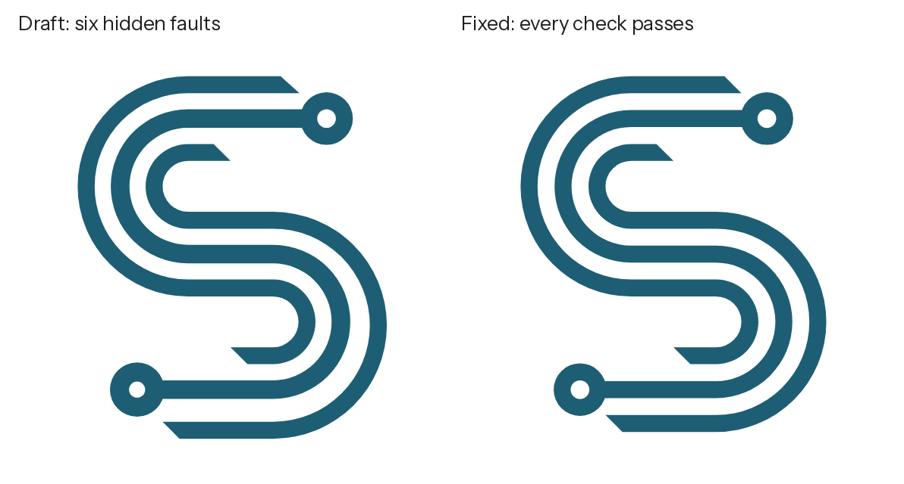

logo-doctor is an agent skill for Claude Code (and any agent that reads `SKILL.md` skill folders), plus a command
line tool you can run yourself. Point it at a logo and it measures what a designer checks by eye: the
construction grid, stroke weights, gaps, curves and shared centres, rings, angles, alignment, symmetry,
balance, small-size legibility, and colour on light and dark backgrounds and for colour-blind viewers. It draws
every finding on the logo, writes a prioritised report and a fix brief, and compares a new version with the old
one. The skill adds what measurements cannot see: fit, concept, optical corrections and the rules a professional
applies.

*Every image in this README comes from a made-up demo mark ([examples/](examples/)), never from a real brand.*

## Contents

- [What it checks](#what-it-checks)
- [A review, step by step](#a-review-step-by-step)
- [The report and the fix brief](#the-report-and-the-fix-brief)
- [What a senior designer checks](#what-a-senior-designer-checks)
- [Prompts and briefs](#prompts-and-briefs)
- [Install](#install)
- [First run](#first-run)
- [Using it with Claude](#using-it-with-claude)
- [Using the tool directly](#using-the-tool-directly)
- [Privacy](#privacy)
- [Requirements and limitations](#requirements-and-limitations)
- [Documentation](#documentation)
- [Related](#related)
- [Contributing](#contributing)
- [Author](#author)
- [License and credits](#license-and-credits)

## What it checks

| Check | What it measures | Image |
|---|---|---|
| Construction grid | the module that explains the key positions, and every edge, centre and corner off it | `01-grid.png` |
| Alignment | edges and centres that almost line up but miss | `01-grid.png` |
| Stroke weights | the width of every stroke, from circles fitted inside it | `02-strokes.png` |
| Gaps and spacing | the width of every gap between facing edges, from circles fitted between them | `03-gaps.png` |
| Circles and curves | rings, dots and holes that should match; arcs that should share a centre; the radius system | `04-circles.png` |
| Angles | the angle system of straight edges, and edges a few degrees off it | `05-angles.png` |
| Symmetry | mirror and 180 degree symmetry, and exactly where a near-symmetric mark breaks it | `06-symmetry.png` |
| Balance | where the visual weight sits, and the ink in each quarter | `07-balance.png` |
| Small sizes | the mark at 16 to 128 px, the size where gaps fill in, a blur test and a silhouette | `08-sizes.png` |
| Colour on backgrounds | contrast on six backgrounds and your brand's, with lighter and darker versions of the same hue | `09-colour-backgrounds.png` |
| Colour vision | protanopia, deuteranopia, tritanopia and greyscale | `10-colour-vision.png` |
| Complexity | parts, counters, edges, and an edge index | in the report |

## A review, step by step

The demo mark is an S drawn as three parallel circuit traces with a ring at each end of the middle trace, built
on a 20-unit grid in a 1000-unit artboard: stroke 40, gap 40, 45 degree cuts, and every bend made of concentric
arcs. It is generated by [examples/make_demo.py](examples/make_demo.py).

The draft version hides six faults of the kind that generated, traced or hurried artwork often has:

1. the middle trace is 44 wide instead of 40;
2. the arcs of one trace in the lower bowl are centred 8 units below the others;
3. the lower ring is 19 / 64 instead of 22 / 62 (hole radius / outer radius);
4. the cut at the end of the top trace is 42 degrees instead of 45;
5. the upper ring sits 6 units right of the grid;
6. because of fault 2, the lowest trace sits 16 units low, which breaks the mark's 180 degree symmetry.

None of them is obvious at a glance; all of them make the mark feel slightly off. Below is how each check found
them, with the draft on the left and the fixed version on the right. The full reports are in
[examples/review-draft](examples/review-draft/report.md) and [examples/review-fixed](examples/review-fixed/report.md).

### 1. The construction grid

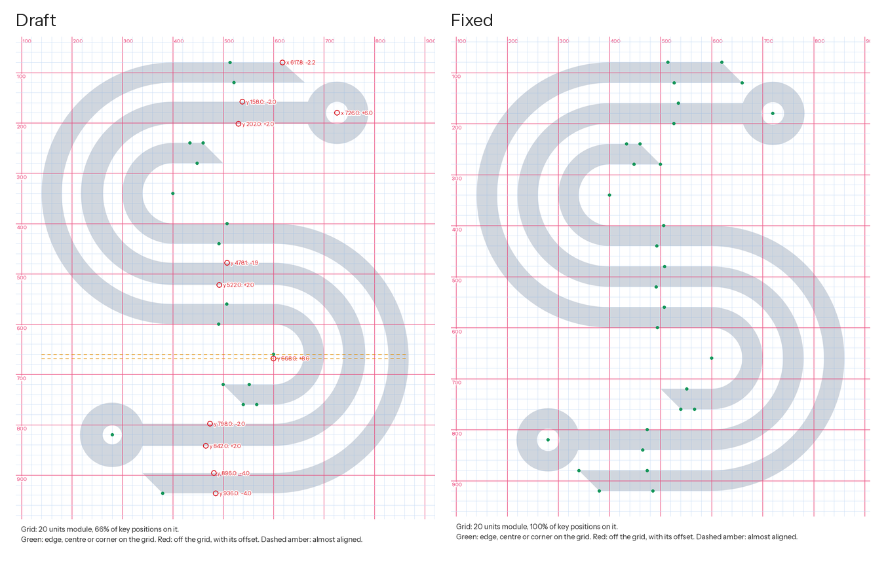

**What a designer looks for.** In a constructed mark, every important position sits on a grid: edges, centres of
curves, corners. Positions that miss by a fraction of a module are the first sign of a mark drawn by eye.

**How it was checked.** The tool collects the key positions (long horizontal and vertical edges, the centres of
arcs and rings, and true corners where two straight edges meet), then tries candidate modules: round numbers from
the file's origin, and whole fractions of the mark's height and width. Each module is scored by how many
positions fall on it beyond what chance would give. Here it found a module of 20 units, which is how the mark was
built.

**What it found.** In the draft, 11 of 32 positions are off the grid (red, with the offset). The tool pairs edges
that belong to one stroke: three strokes have both edges 2 units off in opposite directions, which means the
stroke is too wide (fault 1), and one stroke has both edges 4 units off in the same direction, which means it
sits in the wrong place (fault 6). The upper ring's centre is 6 units right (fault 5), a corner of the top cut is
2.2 units off (fault 4), and one arc centre is 8 units off (fault 2). The dashed amber lines show two centres that
almost line up. In the fixed version every position is green.

### 2. Stroke weights: circles inside every stroke

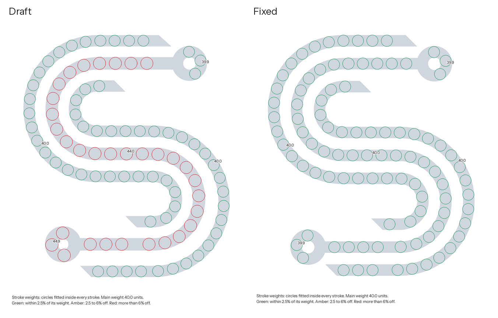

**What a designer looks for.** One stroke weight, or clearly different weights. A difference of a few percent
reads as a mistake, not a decision.

**How it was checked.** Each shape is thinned to its centre line. At every point the tool fits the largest circle
between the two edges, measuring the distance to the nearest edge on each side, so the width is exact even when
the centre line is a pixel off. The circles you see are those measurements; each one's diameter is the stroke's
width there. Points near ends and junctions are left out, because there the circle is not the stroke width.

**What it found.** Every stroke is 40.0 except the middle trace (44.0) and the lower ring (44.9): about 10%
heavier, the "two weights where one is intended" fault (faults 1 and 3). In the fixed version all circles are
green at 40.0.

### 3. Gaps: circles between facing edges

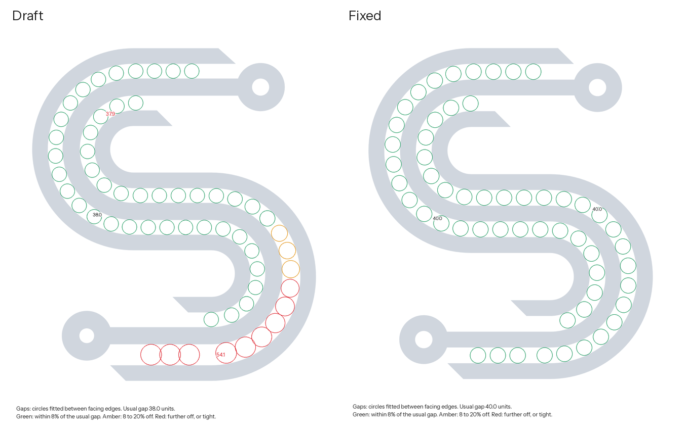

**What a designer looks for.** Parallel strokes stay parallel: the gap between them is constant along their whole
length, including around bends.

**How it was checked.** The same circle method on the empty space, kept only where there is ink on both sides, so
the margin around the logo and open counters are left out. Each gap is measured along its length.

**What it found.** In the draft the gap between the middle trace and the outer lower trace grows from 37.9 to 54.0
units around the lower bowl: the circles turn amber, then red. The cause is in the next check. In the fixed
version every gap is 40.0.

### 4. Circles, rings and shared centres

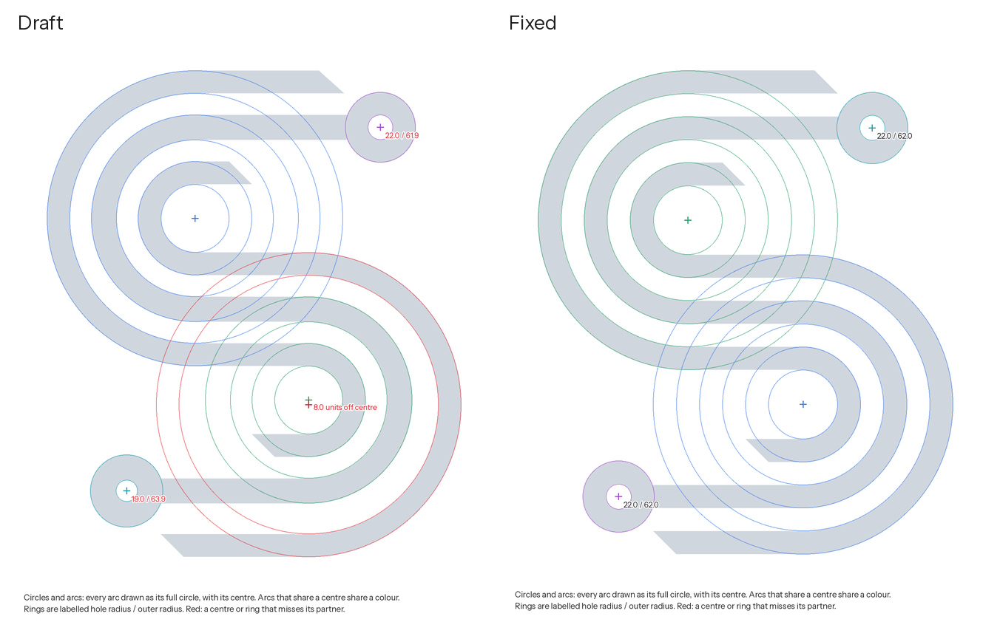

**What a designer looks for.** When parallel strokes bend together, their arcs share one centre. Rings and dots
that look alike are identical.

**How it was checked.** The outline of the mark is split into exact straight runs and circular arcs, and each arc
is drawn here as its full circle with its centre. Arcs that share a centre share a colour. Rings are found as a
round hole with an outer arc around the same centre, and labelled hole radius / outer radius.

**What it found.** In the lower bowl of the draft, one trace's arcs (red) are centred 8 units below the others
(fault 2): that is why the gap in check 3 widens. The rings measure 22.0 / 61.9 and 19.0 / 63.9 (fault 3). In the
fixed version each bowl has one centre and both rings are 22.0 / 62.0.

### 5. Angles

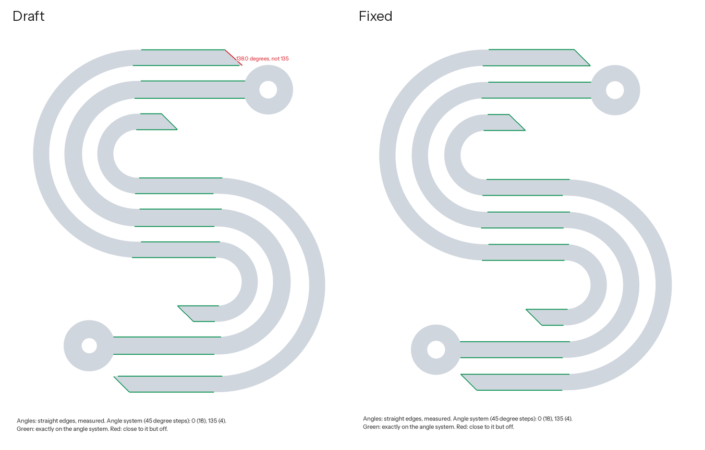

**What a designer looks for.** A small angle system, here 0 and 45 degrees, used exactly. Terminal cuts all at the
same angle.

**How it was checked.** Each long straight edge is fitted precisely and compared with the nearest multiple of 45
degrees. Angles are counted from horizontal, counter-clockwise.

**What it found.** One cut edge in the draft is at 138.0 degrees instead of 135, so the top cut is 42 degrees
where the others are 45 (fault 4). In the fixed version every edge is exactly on the system.

### 6. Symmetry

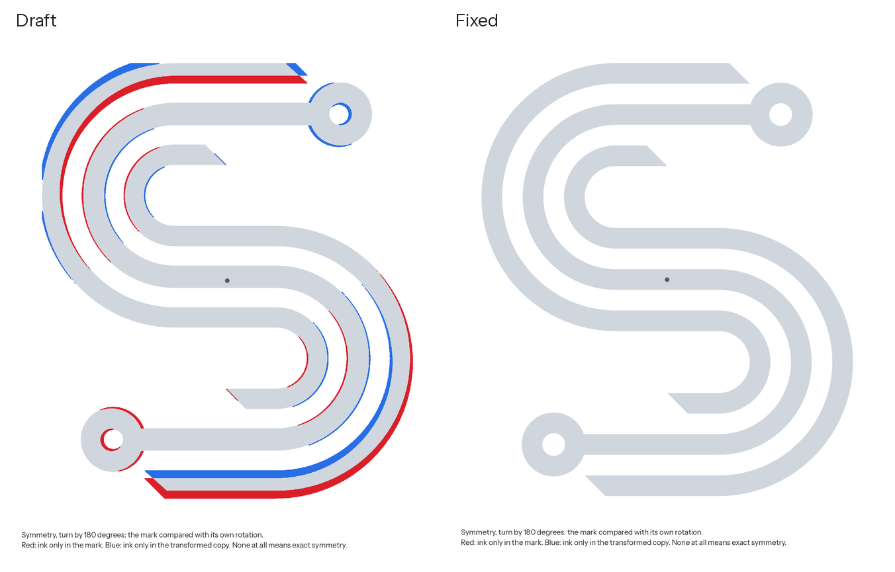

**What a designer looks for.** A symmetric mark must be exactly symmetric; a near miss looks like a mistake.

**How it was checked.** The mark is compared with its mirror images and its rotation by 180 degrees, after moving
the copy to where it fits best, so only the parts that really differ show. Red is ink only in the mark, blue is
ink only in the rotated copy.

**What it found.** The S is designed to look the same upside down. In the draft, the shifted lower trace, the
top trace's cut and the unequal rings break that (faults 2 to 6). The fixed version turns into itself exactly.

### 7. Balance

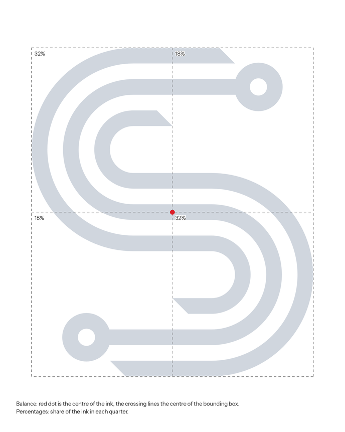

**What a designer looks for.** Visual weight that feels settled: not top-heavy, not leaning, unless that is the
intent.

**How it was checked.** The centre of the ink (red dot) is compared with the centre of the bounding box, and the
ink in each quarter is counted. The fixed S is centred, with 32% in the top left and bottom right quarters and 18%
in the other two, as a turned shape should be.

### 8. Small sizes, blur and silhouette

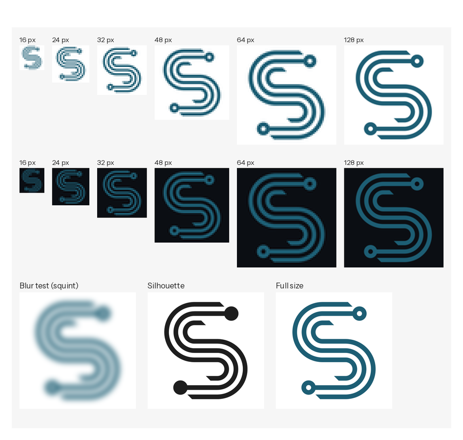

**What a designer looks for.** A mark that still reads at favicon size, and whose idea survives when you squint.

**How it was checked.** The mark is reduced to 16, 24, 32, 48, 64 and 128 pixels and shown with its pixels
visible. From the narrowest gap, the tool works out the height below which gaps fill in. The blur test is the
squint test; the silhouette fills every counter, to show the bare shape.

**What it found.** The S reads from 32 px up. Below about 21 px its 40-unit gaps fill in and the three traces merge,
so for 16 px favicons the review suggests a simplified version. The blur test and the silhouette both still read as
an S, which is a sign of a strong idea.

### 9. Colour on backgrounds

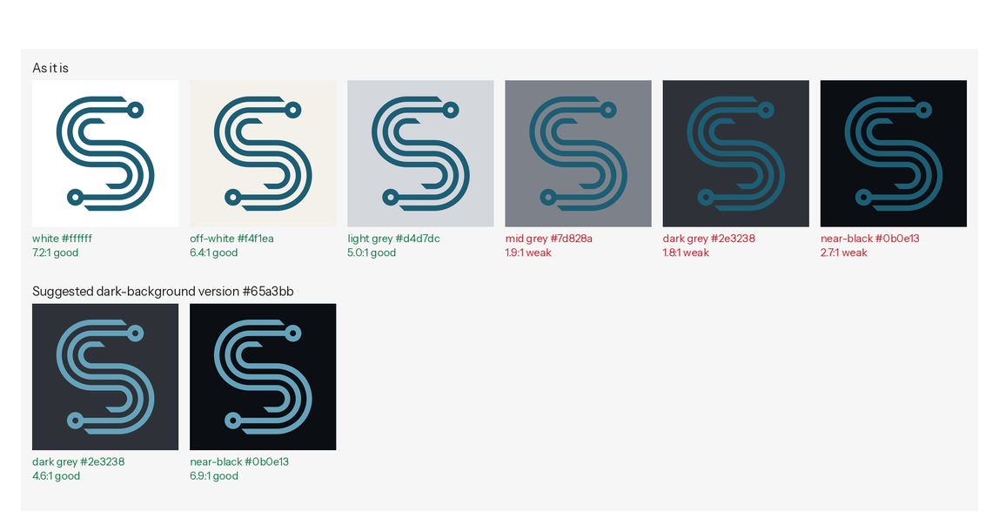

**What a designer looks for.** A colour that holds on the backgrounds the brand uses, and a plan for the ones where
it does not.

**How it was checked.** The contrast ratio (WCAG 2) of the logo colour on white, off-white, light grey, mid grey,
dark grey and near-black, plus any brand backgrounds you pass. Where the colour is weak, the tool proposes a
version with the same hue and chroma, lighter or darker (in OKLCH), until it reaches 4.5:1.

**What it found.** The deep teal #1d5e74 is strong on light backgrounds (7.2:1 on white) and fades on dark ones
(1.8:1 on dark grey, 2.7:1 on near-black). The proposed dark-background version, #65a3bb, reaches 4.6:1 and 6.9:1.
On mid grey no version of the colour is strong, so the advice is the one-colour white or black version. Colour
changes are proposals for the owner, never applied automatically.

### 10. Colour vision and greyscale

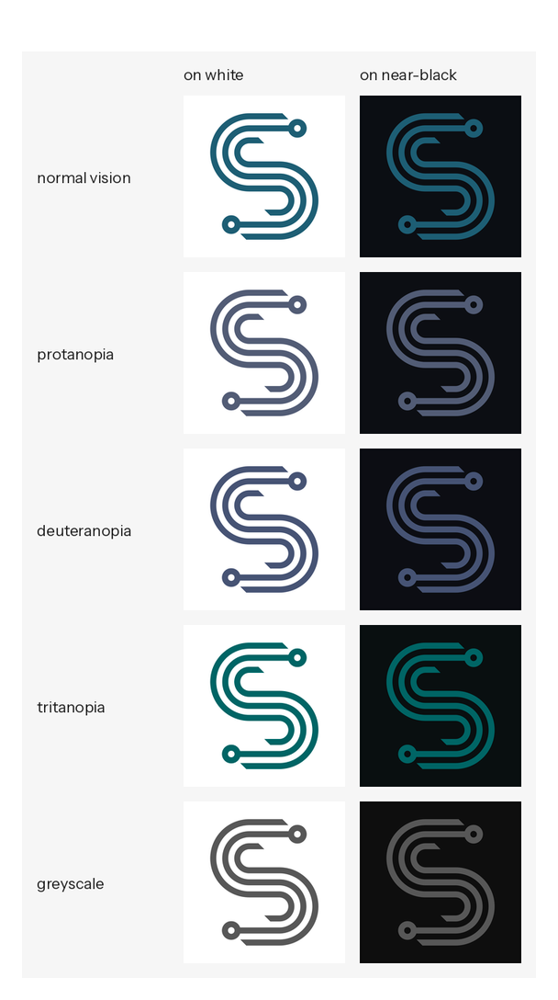

About 1 in 12 men and 1 in 200 women have a colour vision deficiency. The sheet simulates the three common types
(Machado, Oliveira and Fernandes, 2009) and greyscale, on white and near-black. A one-colour mark like this one
depends on lightness, so it reads the same way for everyone; in a multi-colour mark the tool also checks whether
any two colours merge.

## The report and the fix brief

Each review writes a `report.md`. Its scorecard, for the fixed demo compared with the draft
(`--baseline`), reads:

| Check | Before | Result | Finding |
| --- | --- | --- | --- |
| Construction grid | Fix | Pass | every key position sits on a grid of 20 units |
| Alignment | Pass | Pass | no near misses between edges, centres and corners |
| Stroke weights | Fix | Pass | consistent: 40.0 (100% of the stroke length) |
| Gaps and spacing | Fix | Pass | even: the usual gap is 40.0 units |
| Circles and curves | Fix | Pass | circles match and shared centres are exact |
| Angles | Fix | Pass | every straight edge is on the angle system |
| Symmetry | Fix | Pass | exactly symmetric (turn by 180 degrees) |
| Balance | Pass | Pass | the visual weight is centred |
| Small sizes | Check | Check | gaps fill in below about 21 px tall |
| Colour on backgrounds | Check | Check | weak on mid grey, dark grey, near-black |
| Colour vision and greyscale | Pass | Pass | readable with common colour vision deficiencies |

Then come **Fix first** (objective faults, in the order a designer would fix them: geometry, then weights and
spacing, then positions), **Consider** (judgments, such as the favicon version and the dark-background colour),
and every measurement in detail. Faults with one cause are grouped: one wrong stroke width is one fix, not two
off-grid edges.

`fix-brief.md` turns the findings into instructions for an agent editing the SVG (exact coordinates, what must not
change, and how to verify with a second review) and a brief for a human designer. See the
[draft's fix brief](examples/review-draft/fix-brief.md).

## What a senior designer checks

The measurements cover construction. The skill also carries the judgment an experienced identity designer applies,
in [references/](skills/logo-doctor/references/), so the agent can review what numbers cannot see:

- **The order of a review:** fit first, then the idea, silhouette, construction, optics, scale, colour, type, the
  system, and legal risk.
- **The five qualities** design teachers list (simple, memorable, timeless, versatile, appropriate), each with a
  practical test: the ten-second memory sketch, the squint test, the one-colour test.
- **Space and perception:** figure and ground, Gestalt grouping, rhythm.
- **Construction:** grids, weight tiers, gap ratios, concentric bends, radius systems, angle systems, terminals,
  joins and corners.
- **Optical corrections:** overshoot of round shapes, thinner horizontals, the optical centre, smaller upper parts
  in stacked forms, irradiation of light shapes on dark grounds.
- **Colour:** lightness before hue, OKLCH variants for dark and light backgrounds, mid tones and photographs,
  colour vision, print and metallics.
- **The logo system:** versions, clear space, minimum sizes, misuse.
- **Originality and legal basics:** resemblance, trademark searches, and the copyright position of generated
  artwork.
- **A process for new marks:** brief, research, ideas, construction on a grid, checks, optical pass, presentation.

## Prompts and briefs

[references/prompts.md](skills/logo-doctor/references/prompts.md) has ready-made texts: asking for a review,
fixing a logo with an agent, a designer brief, a brief for a new mark, a careful prompt for exploring concepts in an
image tool, rebuilding a raster logo as clean geometry, and questions for gathering people's feedback. For example:

```
Review our logo <path/to/logo.svg> like a senior identity designer.
We are <what the business does> for <audience>. It is used on <website, app icon, social avatars, print>.
Our backgrounds are <#hex light> and <#hex dark>. Official colours: <#hex>.
Measure the construction, check colour on our backgrounds, and give me a prioritised list:
what to fix, what to consider, and what to keep. Do not change the file.
```

## Install

### Option 1: Claude Code plugin

Inside Claude Code:

```
/plugin marketplace add ali-raza-arain/logo-doctor-skill
/plugin install logo-doctor@logo-doctor
```

The skill is then available in every project; Claude loads it when you ask about a logo, or you can ask for it by
name.

### Option 2: copy the skill folder

```bash
git clone https://github.com/ali-raza-arain/logo-doctor-skill.git
cp -r logo-doctor-skill/skills/logo-doctor ~/.claude/skills/        # for all your projects
# or, for one project only:
cp -r logo-doctor-skill/skills/logo-doctor /path/to/project/.claude/skills/
```

Other agents that support `SKILL.md` skill folders can use the same folder.

### Option 3: upload as a ZIP

```bash
python tools/package_skill.py        # writes dist/logo-doctor.zip
```

Upload the ZIP where your Claude app lets you add a skill. The tool renders with a local Chromium and installs
Python packages on first use; it was built and tested for local agents such as Claude Code, and a hosted sandbox
may not allow that setup.

## First run

One command installs the Python packages and a headless Chromium into a private virtual environment at
`~/.cache/logo-doctor` (nothing system-wide):

```bash
bash skills/logo-doctor/scripts/setup_env.sh
```

When you use the skill through Claude, Claude runs this for you the first time. To check everything works:

```bash
~/.cache/logo-doctor/venv/bin/python tests/smoke_test.py
```

The test builds the demo marks, reviews them, and checks that all six faults in the draft are found and that the
fixed version passes, as an SVG and as a PNG.

## Using it with Claude

Put the logo in your project and ask in your own words:

- "Check our logo `brand/logo.svg`. Is it professionally built? What should we fix?"
- "Our logo looks a bit off and I can't say why. Find out."
- "Will this logo work on our dark website header? If not, what colour should we use there?"
- "Make a brief for a designer to clean up our logo."
- "We need a new logo. Give me the rules and a brief, then build two directions on a grid and check them."

Claude gathers what it needs (the best file, the official colours, where the logo is used), runs the review, looks
at every image, verifies each finding (a tapering stroke may be a choice, not a fault), adds the judgment
measurements cannot give, and writes the feedback: verdict, strengths, fix first, consider, colour plan, small
sizes, next steps. It changes nothing unless you ask, and then only a copy, with a second review to show the
before and after.

## Using the tool directly

```bash
PY=~/.cache/logo-doctor/venv/bin/python
$PY skills/logo-doctor/scripts/review.py logo.svg --out review-1 --name "Brand"
```

| Option | Use |
|---|---|
| `--out` | new folder for the report, brief, findings and images |
| `--name` | the name used in the report title |
| `--snap 45` | the angle system in degrees; 30 or 15 for other systems, 0 for none |
| `--grid 20` | the grid module, if you know it (otherwise detected) |
| `--grid-origin 0,0` | the grid's origin, with `--grid` |
| `--bg "navy=#0e1f38"` | an extra background to test, repeatable |
| `--colours "#1d5e74,#e0a030"` | the official colours, if the file's are not final |
| `--baseline review-1/findings.json` | compare with an earlier review (adds a Before column) |
| `--force` | allow writing into a folder that is not empty |

SVG is measured in its own units and is far more precise; PNG and JPG work too, measured in source pixels. Try it
on the demo: `$PY examples/make_demo.py work && $PY skills/logo-doctor/scripts/review.py work/demo-draft.svg --out work/review`.
More in [docs/cli.md](docs/cli.md).

## Privacy

Logos are often unreleased or confidential, so everything runs on your machine. No tool sends your logo anywhere,
and the skill tells the agent never to upload it to websites, image generators, design tools or storage. The only
network use is the one-time setup (Python packages from PyPI and Chromium from Playwright's servers). When you
report a bug, please use the demo mark or a logo you are free to share.

## Requirements and limitations

- Python 3.10 or newer; Linux or macOS (on Windows, use WSL, or install `requirements.txt` and run
  `python -m playwright install chromium`). A few hundred MB of disk for Chromium.
- A review takes about half a minute on a normal laptop.
- Measurements find construction faults precisely but do not know intent: tapering strokes, deliberate offsets
  and optical corrections are flagged too. The skill tells the agent to verify each one; when you run the tool
  directly, read the report with the images.
- Hand-drawn and traced marks are not built from circles and grids, so they produce many small findings; read them
  as a pattern ("the curves are freehand") rather than a list of errors.
- Gradients, textures and photographs are measured as flat colours; 3D renders are out of scope.
- It cannot tell whether a logo is original or registrable. That needs a trademark search by a professional.

## Documentation

- [skills/logo-doctor/SKILL.md](skills/logo-doctor/SKILL.md): the workflow the agent follows.
- [references/principles.md](skills/logo-doctor/references/principles.md): what a senior designer checks, and the
  process for a new mark.
- [references/construction.md](skills/logo-doctor/references/construction.md): grids, weights, gaps, curves,
  angles and optical corrections.
- [references/colour.md](skills/logo-doctor/references/colour.md): choosing colours, light and dark versions,
  print, colour vision.
- [references/fixing.md](skills/logo-doctor/references/fixing.md): how to fix each kind of fault.
- [references/prompts.md](skills/logo-doctor/references/prompts.md): prompts and briefs.
- [references/feedback.md](skills/logo-doctor/references/feedback.md): how to write the review, with an example.
- [references/measurements.md](skills/logo-doctor/references/measurements.md): how each check works, its
  thresholds and its false positives.
- [docs/cli.md](docs/cli.md) and [docs/troubleshooting.md](docs/troubleshooting.md).

## Related

[logo-repolish](https://github.com/ali-raza-arain/logo-repolish-skill) rebuilds a raster logo as a precise vector
and exports a complete brand kit. The two work together: rebuild with logo-repolish, review with logo-doctor, fix,
then export the kit.

## Contributing

Issues and pull requests are welcome. Please read [CONTRIBUTING.md](CONTRIBUTING.md): run the smoke test, keep the
tool local-only, and attach only images you are free to share.

## Author

logo-doctor is written and maintained by Ali Raza ([github.com/ali-raza-arain](https://github.com/ali-raza-arain)).
If it helps you, a star on the repository helps others find it.

## License and credits

Copyright (c) 2026 Ali Raza. The code and documentation are under the [MIT License](LICENSE).

The bundled font, Instrument Sans, is by the Instrument Sans Project Authors under the SIL Open Font License 1.1
([its license](skills/logo-doctor/assets/fonts/OFL.txt)); it labels the review images. Colour vision simulation uses
the matrices published by Machado, Oliveira and Fernandes (2009); OKLab and OKLCH are by Bjorn Ottosson. Other
dependencies are listed in [THIRD_PARTY_NOTICES.md](THIRD_PARTY_NOTICES.md).
