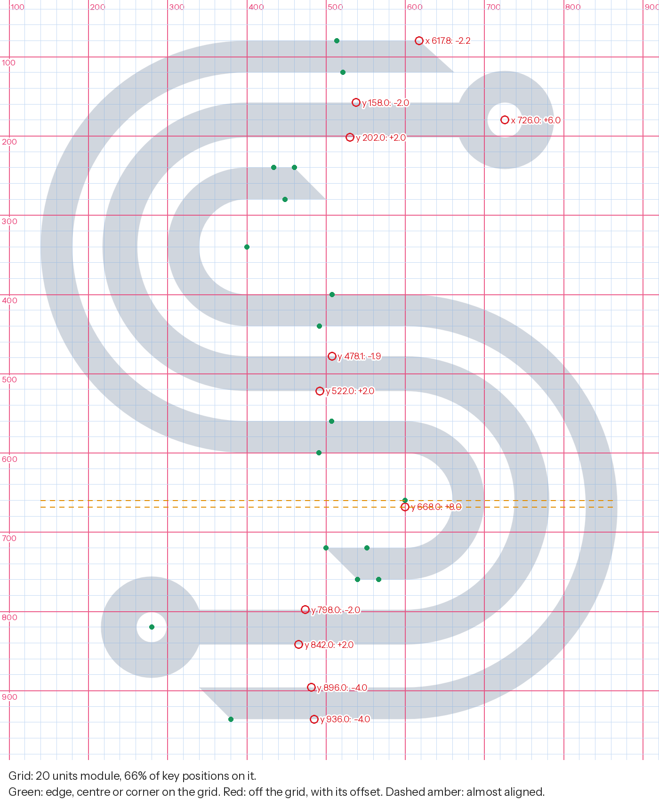
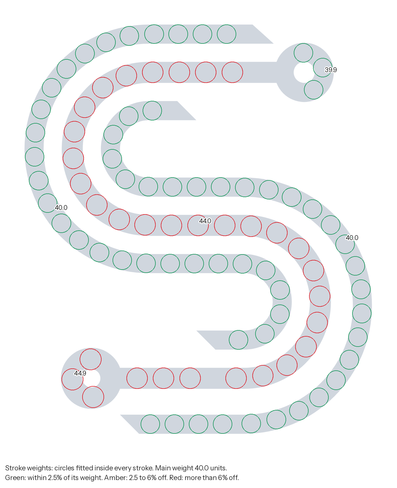
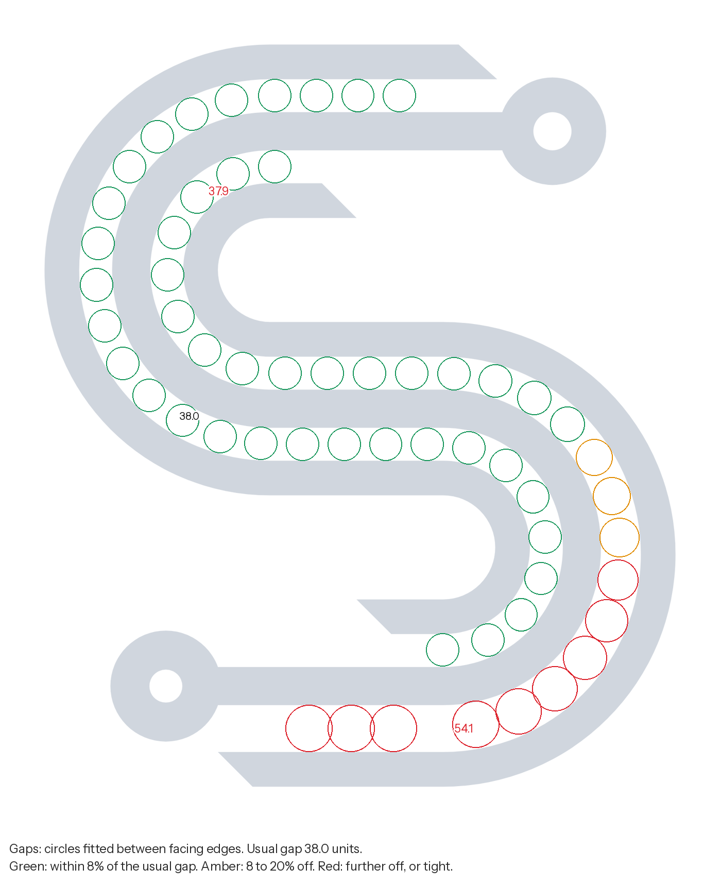
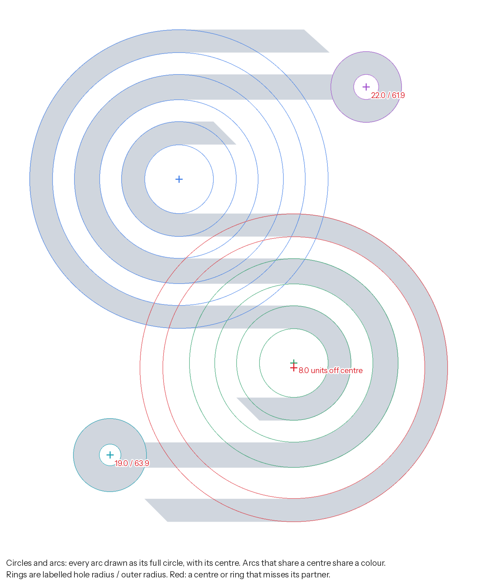
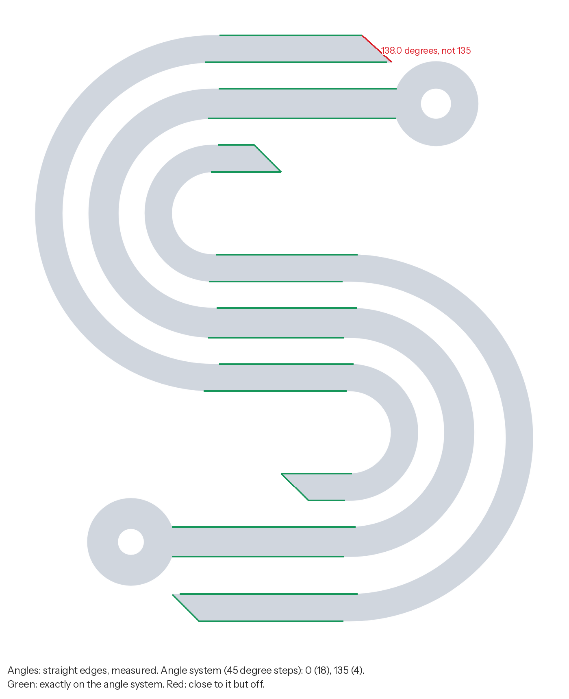
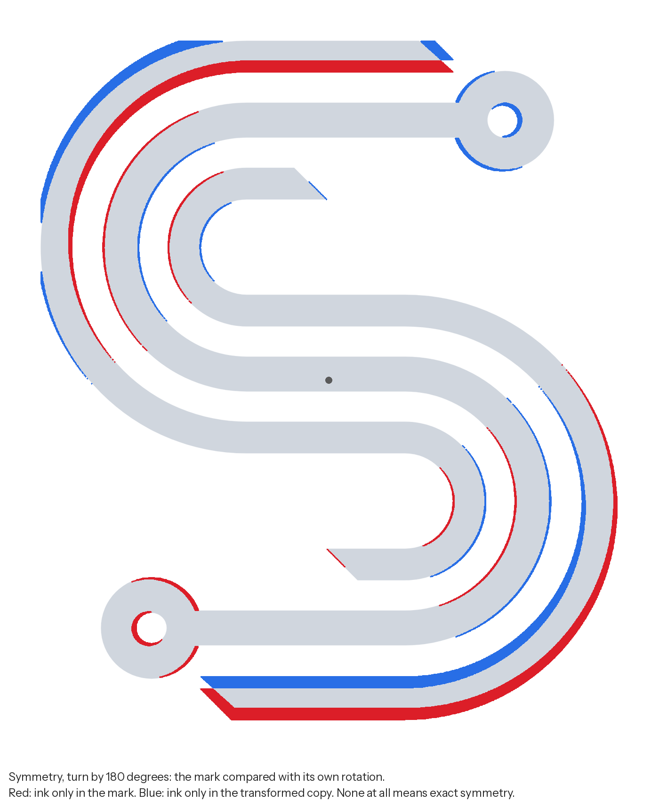
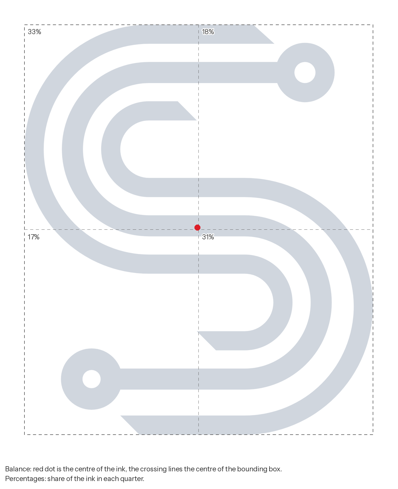
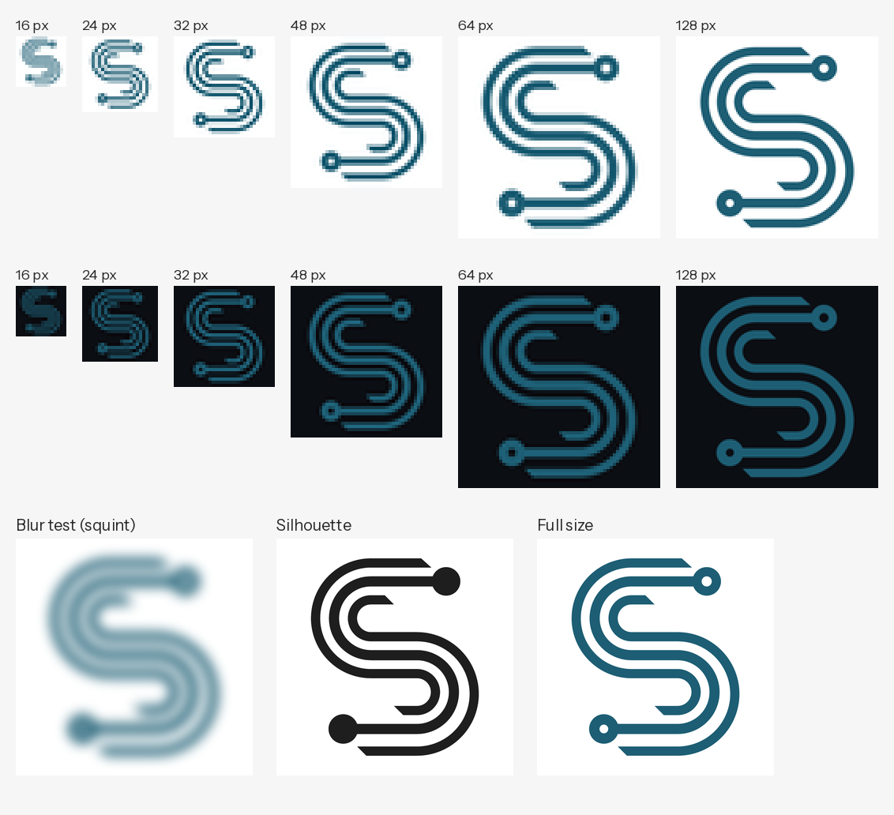
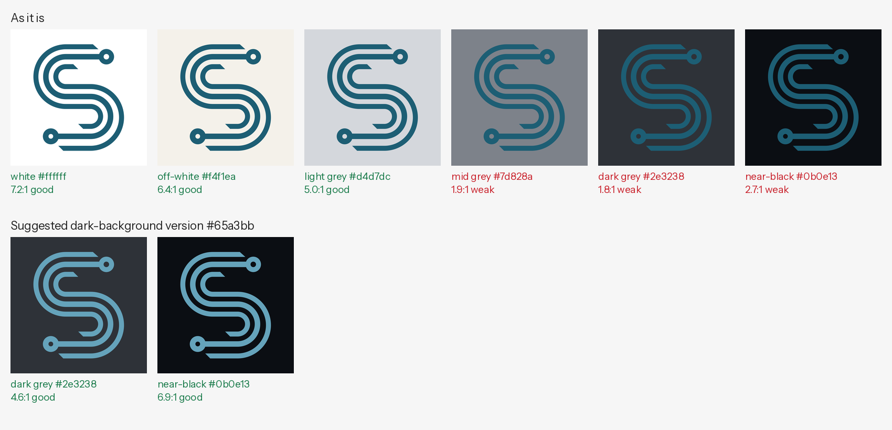
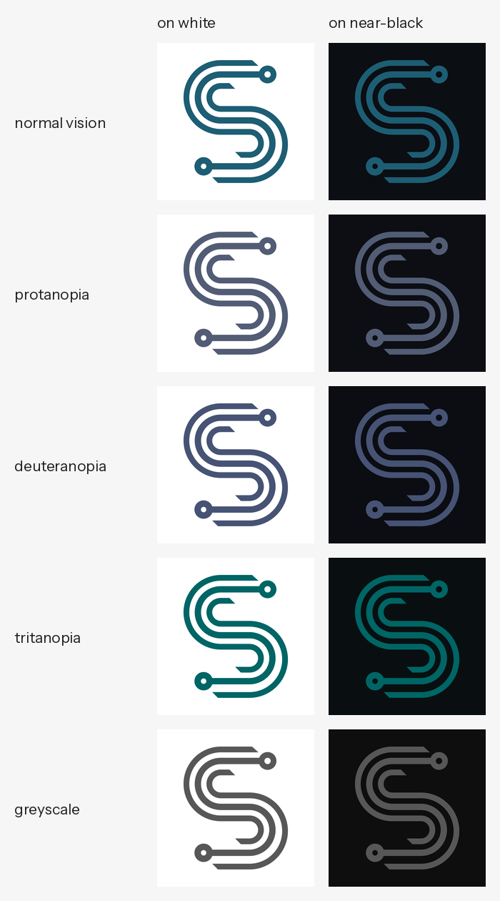

# Logo review: Demo mark, draft

File: `demo-draft.svg` (svg). Measured in the file's own units; the mark is 727.8 by 856.3 units. Colours: #1d5e74.

Automated measurements find construction faults precisely, but they do not judge intent. Read each item with the images and decide whether it is a fault or a choice.

## Scorecard

| Check | Result | Finding |
| --- | --- | --- |
| Construction grid | Fix | 11 of 32 key positions off the grid of 20 units |
| Alignment | Pass | 1 near miss, already covered by the grid fixes |
| Stroke weights | Fix | 2 weights where one is intended: 40.0 and 44.0 |
| Gaps and spacing | Fix | 1 uneven gap |
| Circles and curves | Fix | 1 set of circles that should match, 1 centre just off its partner |
| Angles | Fix | 1 edge a few degrees off the 45 degree system |
| Symmetry | Fix | almost symmetric (turn by 180 degrees), but parts differ by up to 16.0 units |
| Balance | Pass | the visual weight is centred |
| Small sizes | Check | Gaps fill in below about 23 px tall, so the 16 to 32 px favicon sizes blur |
| Colour on backgrounds | Check | weak on mid grey, dark grey, near-black |
| Colour vision and greyscale | Pass | readable with common colour vision deficiencies |
| Complexity | Info | 3 parts, 2 enclosed counters, 23 straight edges, 23 arcs |

## Fix first

In this order: geometry first, then weights and spacing, then positions.

1. **Circles and curves.**
   - Circles that are meant to match differ: 22.0/61.9 at 726.0, 180.0; 19.0/63.9 at 280.0, 820.0. Give them all one size.
   - Arcs centred at 600.0, 668.0 sit 8.0 units from the centre 600.0, 660.0 of the arcs next to them. Make them concentric, keeping the radii that give equal gaps.
2. **Angles.** Set the edge at 639.8, 99.8 to exactly 135 degrees (now 138.0).
3. **Gaps and spacing.** The gap near 560.0, 569.3 changes from 37.9 to 54.0 units. Make the facing edges parallel; where they are arcs, give them one centre.
4. **Stroke weights.** Two weights 40.0 and 44.0 differ by 10%: too little to read as a decision. Set the strokes at 44.0 (near 499.7, 500.7; near 257.5, 819.1) to 40.0, or make the difference at least 15 to 20%.
5. **Construction grid.**
   - The horizontal stroke between y = 158.0 and 202.0 is 44.0 wide; its centre line is on the grid, so correcting its weight puts both edges on the grid.
   - The horizontal stroke between y = 478.1 and 522.0 is 44.0 wide; its centre line is on the grid, so correcting its weight puts both edges on the grid.
   - The horizontal stroke between y = 798.0 and 842.0 is 44.0 wide; its centre line is on the grid, so correcting its weight puts both edges on the grid.
   - The horizontal stroke between y = 896.0 and 936.0 sits 4.0 units off the grid: move it +4.0 units.
   - Move the corner at x = 617.8 to 620 (+2.2 units).
   - Move the arc centre at x = 726.0 to 720 (-6.0 units).
   - and 1 more of the same kind (see Details).
6. **Symmetry.** The mark is almost symmetric (turn by 180 degrees); the red and blue areas break it. Fix the items above first and review again; if a difference remains, rebuild one half from the other, or make the difference large enough to read as intended.

## Consider

- **Stroke weights.** Horizontal parts (40.0) are as heavy as vertical ones (40.0). Horizontals look heavier than verticals of the same width; type designers often draw them 5 to 10% lighter. Optional for a geometric monoline mark.
- **Circles and curves.** Radii 220.0 and 228.0 (centres 400.0, 340.0 and 600.0, 668.0) differ by a hair: equal by intent?
- **Circles and curves.** Radii 259.9 and 268.0 (centres 400.0, 340.0 and 600.0, 668.0) differ by a hair: equal by intent?
- **Small sizes.** Gaps fill in below about 23 px tall, so the 16 to 32 px favicon sizes blur. For favicons and small avatars, consider a simplified version with fewer, wider gaps.
- **Colour on backgrounds.** #1d5e74 is weak on dark grey, near-black. For dark backgrounds, a lighter version with the same hue, #65a3bb, gives dark grey 4.6:1, near-black 6.9:1. Use it only with the owner's agreement; the one-colour white or black version is the other option.
- **Colour on backgrounds.** On mid tones (mid grey) no version of the colour is strong. Use the one-colour white or black version there, or keep the logo off mid-tone and busy photo areas.

## Details

### Construction grid: Fix

11 of 32 key positions off the grid of 20 units.

Module 20 units from origin 0, 0; the mark is 36.4 by 42.8 modules. 21 of 32 key positions are on it (tolerance 1.28 units).
- corner at x = 617.8: -2.2 units from the grid line 620
- arc centre at x = 726.0: +6.0 units from the grid line 720
- horizontal edge at y = 158.0: -2.0 units from the grid line 160
- horizontal edge at y = 202.0: +2.0 units from the grid line 200
- horizontal edge at y = 478.1: -1.9 units from the grid line 480
- horizontal edge at y = 522.0: +2.0 units from the grid line 520
- arc centre at y = 668.0: +8.0 units from the grid line 660
- horizontal edge at y = 798.0: -2.0 units from the grid line 800
- horizontal edge at y = 842.0: +2.0 units from the grid line 840
- horizontal edge at y = 896.0: -4.0 units from the grid line 900
- horizontal edge at y = 936.0: -4.0 units from the grid line 940

### Alignment: Pass

1 near miss, already covered by the grid fixes.

- y = 660.0 (arc centre), 668.0 (arc centre): spread over 8.0 units (resolved by the grid fix)

### Stroke weights: Fix

2 weights where one is intended: 40.0 and 44.0.

Weights found: 40.0 (63% of the stroke length), 44.0 (37% of the stroke length).

| Part near (x, y) | Width (units) | 10th to 90th percentile | Length |
| --- | --- | --- | --- |
| 499.7, 500.7 | 44.0 | 43.9 to 44.0 | 1552 |
| 605.1, 601.9 | 40.0 | 39.9 to 40.0 | 1361 |
| 400.4, 405.3 | 40.0 | 39.9 to 40.0 | 1341 |
| 746.1, 182.2 | 39.9 | 39.9 to 40.0 | 143 |
| 257.5, 819.1 | 44.9 | 44.9 to 45.0 | 130 |

Main weight by direction: horizontal 40.0, vertical 40.0, diagonal 40.0.

### Gaps and spacing: Fix

1 uneven gap.

Usual gap 38.0 units; narrowest 37.9. Gap to stroke ratio 0.95.
- Gap near 446.5, 425.7: median 38.0, from 37.9 to 38.0, length 1307
- Gap near 560.0, 569.3: median 38.9, from 37.9 to 54.0, length 1278

### Circles and curves: Fix

1 set of circles that should match, 1 centre just off its partner.

2 rings, 0 dots, 0 round holes; 5 distinct arc centres.
- Ring at 726.0, 180.0: hole radius 22.0, outer radius 61.9
- Ring at 280.0, 820.0: hole radius 19.0, outer radius 63.9
- Arc centre 400.0, 340.0: radii 60.0, 100.0, 138.0, 182.0, 220.0, 259.9
- Arc centre 600.0, 660.0: radii 60.0, 100.0, 138.0, 182.0
- Arc centre 600.0, 668.0: radii 228.0, 268.0

### Angles: Fix

1 edge a few degrees off the 45 degree system.

22 straight edges measured. Angles found (0 is horizontal, 90 vertical, y up): 0 (18), 135 (4).
- Edge at 639.8, 99.8, length 58: 138.02 degrees, 3.02 off 135

### Symmetry: Fix

Almost symmetric (turn by 180 degrees), but parts differ by up to 16.0 units.

- mirror left to right: no; largest difference 153.4 units; overlap 40%
- mirror top to bottom: no; largest difference 153.4 units; overlap 36%
- turn by 180 degrees: nearly; largest difference 16.0 units; overlap 83%

### Balance: Pass

The visual weight is centred.

Centre of ink is 0% of the width left and 1% of the height above the box centre. Top half 51%, left half 50%. Ink covers 36% of the box.

### Small sizes: Check

Gaps fill in below about 23 px tall, so the 16 to 32 px favicon sizes blur.

Thinnest stroke 39.9 units (4.7% of the height).
Narrowest gap 37.9 units: under 1 pixel when the mark is shorter than about 23 px, so it fills in there.

### Colour on backgrounds: Check

Weak on mid grey, dark grey, near-black.

Colours: #1d5e74 (100% of the ink; OKLCH 0.45 0.073 225).

| Background | Contrast | Grade |
| --- | --- | --- |
| white #ffffff | 7.2:1 | good |
| off-white #f4f1ea | 6.4:1 | good |
| light grey #d4d7dc | 5.0:1 | good |
| mid grey #7d828a | 1.9:1 | weak |
| dark grey #2e3238 | 1.8:1 | weak |
| near-black #0b0e13 | 2.7:1 | weak |
- protanopia: contrast on white 6.7:1, on near-black 2.9:1
- deuteranopia: contrast on white 7.6:1, on near-black 2.5:1
- tritanopia: contrast on white 6.9:1, on near-black 2.8:1
- greyscale: contrast on white 7.2:1, on near-black 2.7:1

### Colour vision and greyscale: Pass

Readable with common colour vision deficiencies.

See the simulation sheet: protanopia and deuteranopia (red-green), tritanopia (blue-yellow), greyscale. About 1 in 12 men and 1 in 200 women have a colour vision deficiency.

### Complexity: Info

3 parts, 2 enclosed counters, 23 straight edges, 23 arcs.

Edge index 23.0 (outline length over the square root of the ink area). Simple marks are often under 15; detailed ones over 30. A higher number is not wrong, but it costs small-size legibility.

