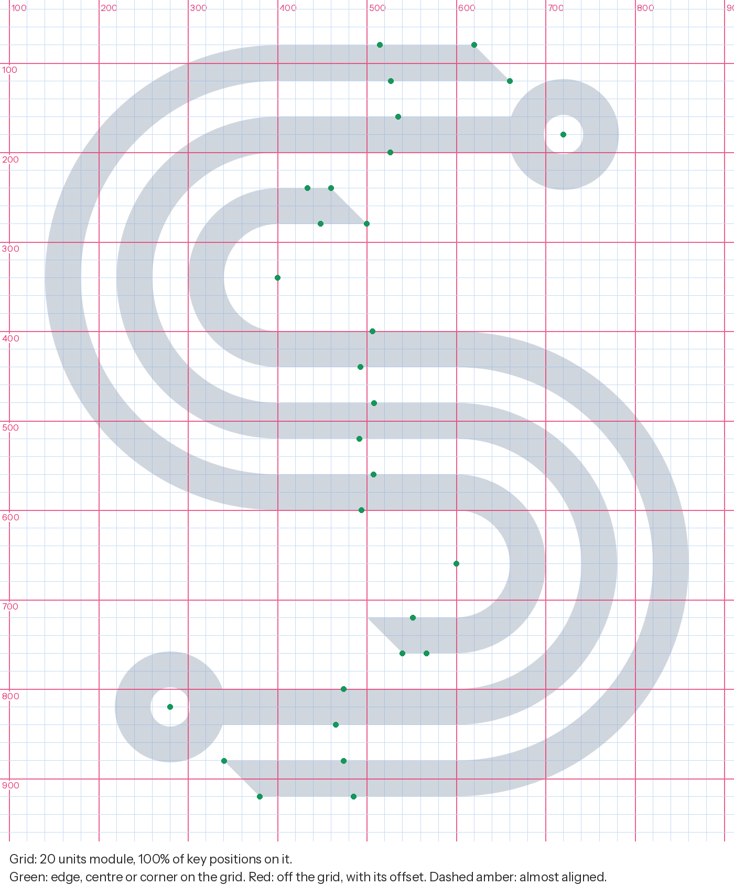
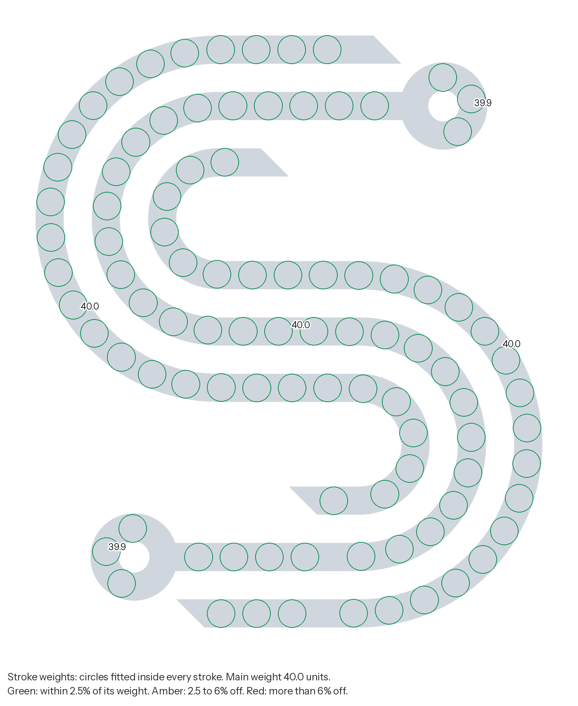
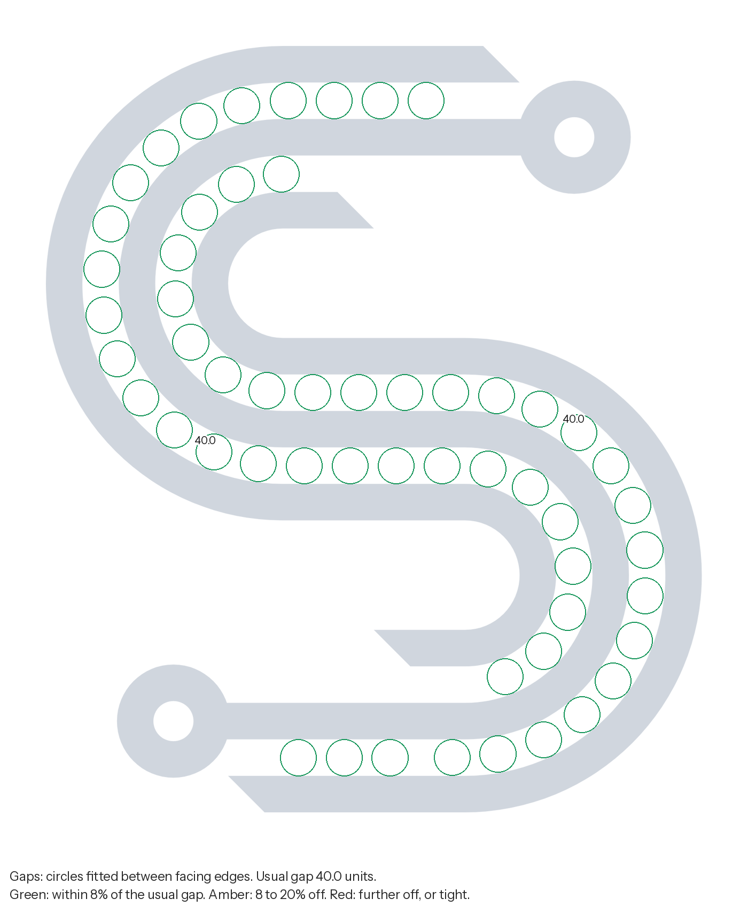
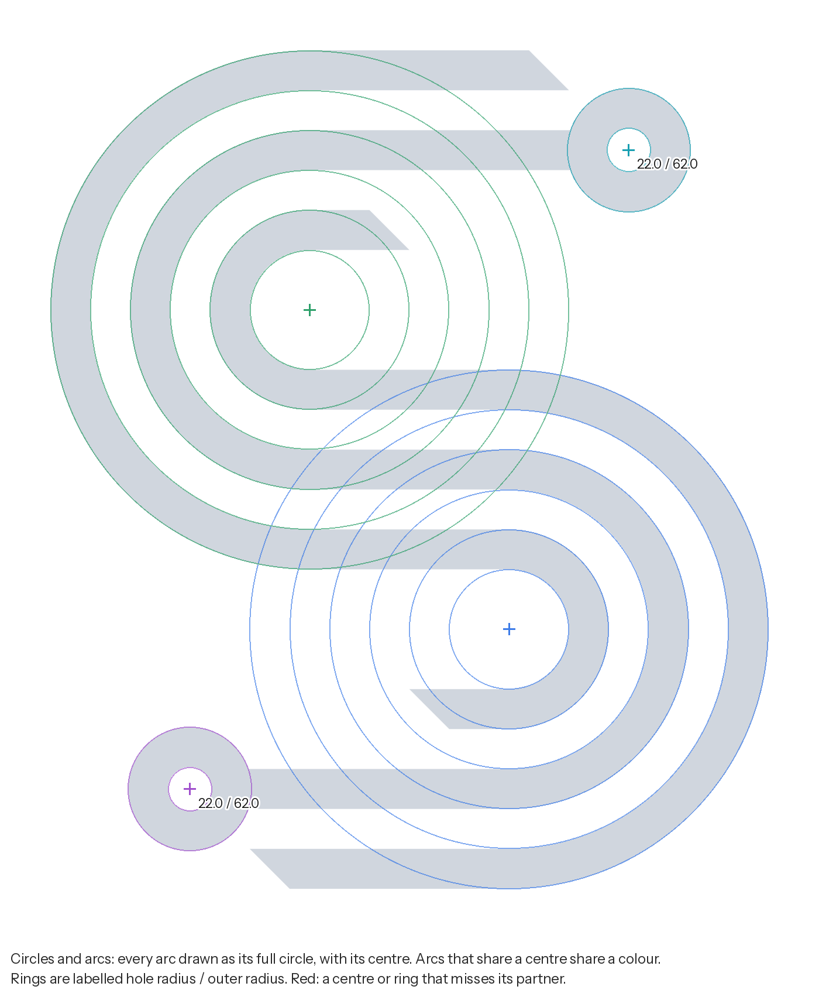
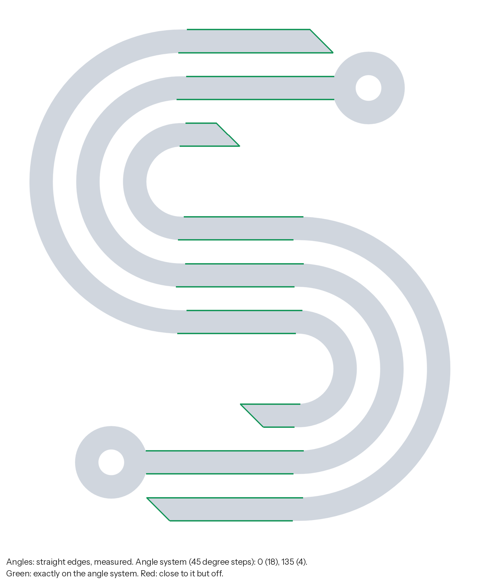
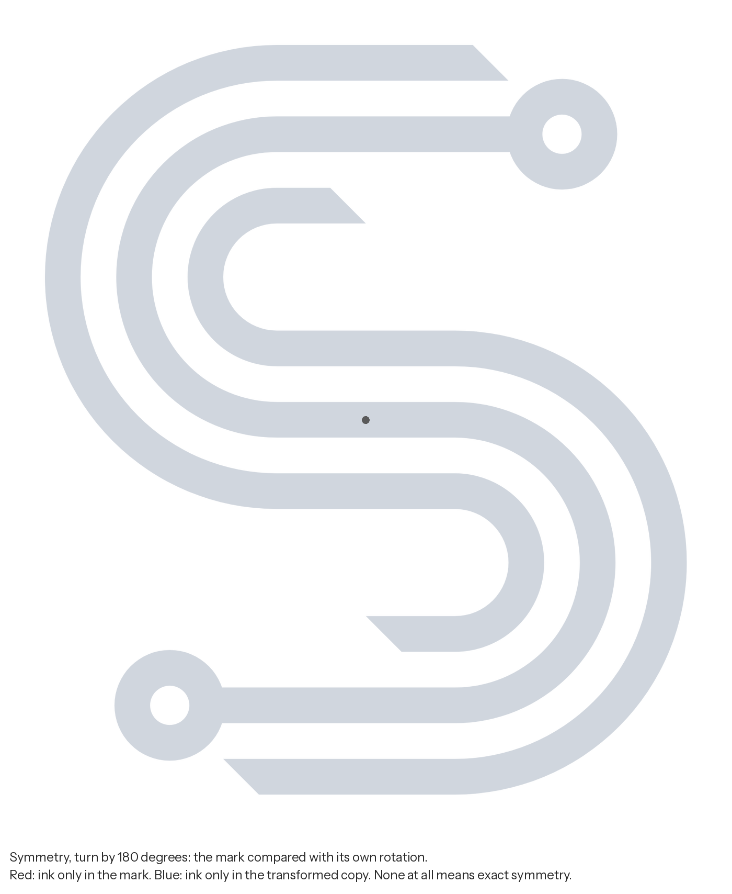
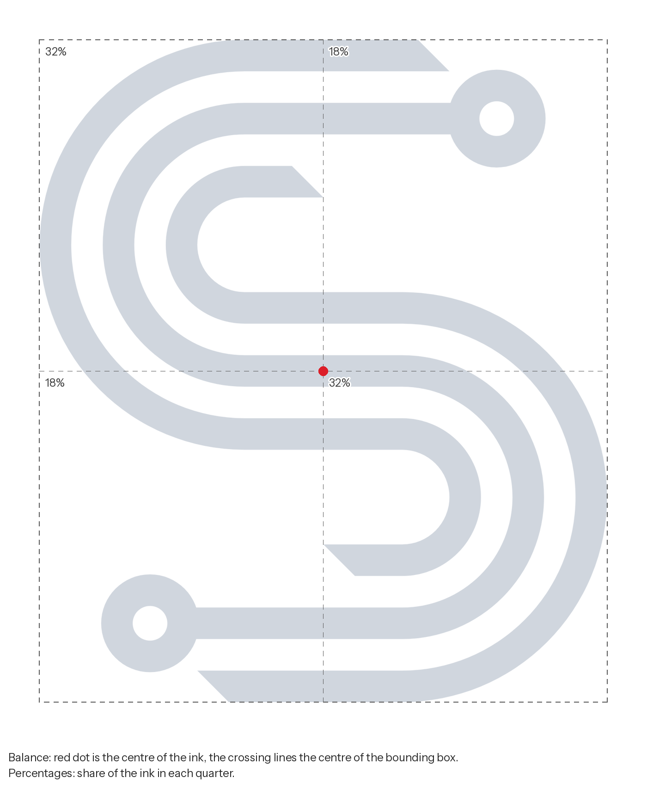
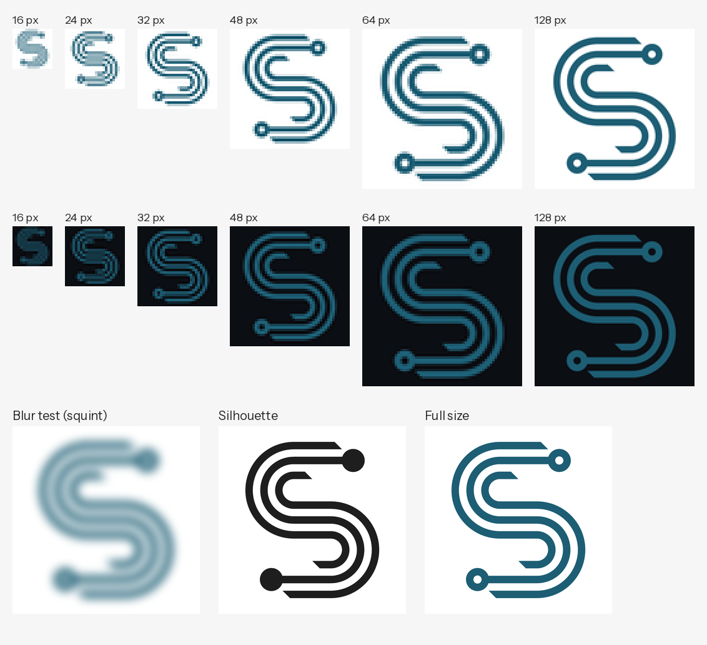
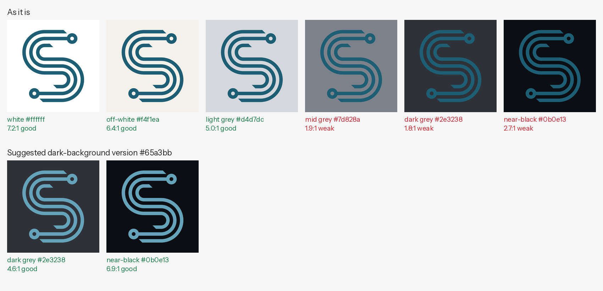
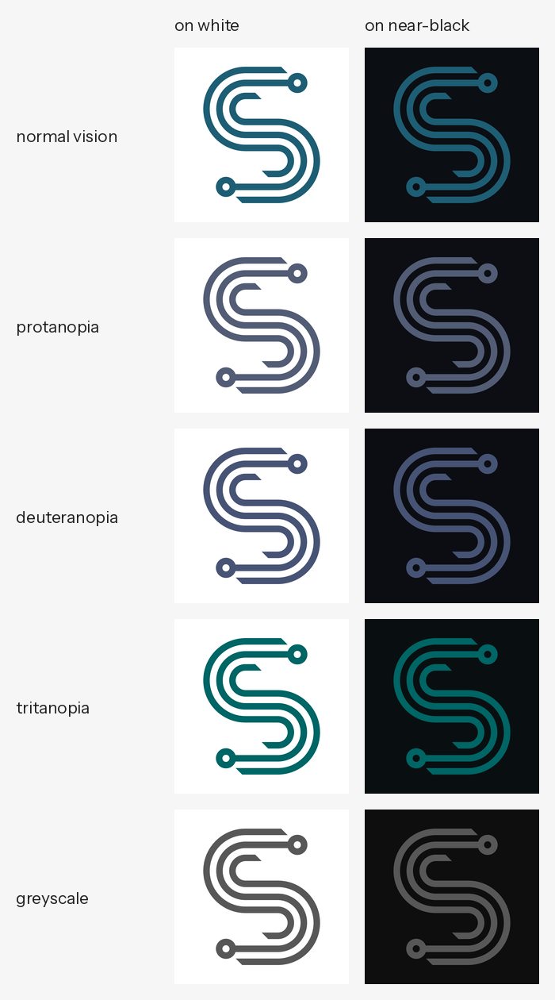

# Logo review: Demo mark, fixed

File: `demo-fixed.svg` (svg). Measured in the file's own units; the mark is 719.9 by 840.0 units. Colours: #1d5e74.

Automated measurements find construction faults precisely, but they do not judge intent. Read each item with the images and decide whether it is a fault or a choice.

## Scorecard

| Check | Before | Result | Finding |
| --- | --- | --- | --- |
| Construction grid | Fix | Pass | every key position sits on a grid of 20 units |
| Alignment | Pass | Pass | no near misses between edges, centres and corners |
| Stroke weights | Fix | Pass | consistent: 40.0 (100% of the stroke length) |
| Gaps and spacing | Fix | Pass | even: the usual gap is 40.0 units |
| Circles and curves | Fix | Pass | circles match and shared centres are exact |
| Angles | Fix | Pass | every straight edge is on the angle system (0 (18), 135 (4)) |
| Symmetry | Fix | Pass | exactly symmetric (turn by 180 degrees) |
| Balance | Pass | Pass | the visual weight is centred |
| Small sizes | Check | Check | Gaps fill in below about 21 px tall, so the 16 to 32 px favicon sizes blur |
| Colour on backgrounds | Check | Check | weak on mid grey, dark grey, near-black |
| Colour vision and greyscale | Pass | Pass | readable with common colour vision deficiencies |
| Complexity | Info | Info | 3 parts, 2 enclosed counters, 23 straight edges, 17 arcs |

## Fix first

In this order: geometry first, then weights and spacing, then positions.

Nothing: no construction faults found.

## Consider

- **Stroke weights.** Horizontal parts (40.0) are as heavy as vertical ones (40.0). Horizontals look heavier than verticals of the same width; type designers often draw them 5 to 10% lighter. Optional for a geometric monoline mark.
- **Small sizes.** Gaps fill in below about 21 px tall, so the 16 to 32 px favicon sizes blur. For favicons and small avatars, consider a simplified version with fewer, wider gaps.
- **Colour on backgrounds.** #1d5e74 is weak on dark grey, near-black. For dark backgrounds, a lighter version with the same hue, #65a3bb, gives dark grey 4.6:1, near-black 6.9:1. Use it only with the owner's agreement; the one-colour white or black version is the other option.
- **Colour on backgrounds.** On mid tones (mid grey) no version of the colour is strong. Use the one-colour white or black version there, or keep the logo off mid-tone and busy photo areas.

## Details

### Construction grid: Pass

Every key position sits on a grid of 20 units.

Module 20 units from origin 0, 0; the mark is 36.0 by 42.0 modules. 33 of 33 key positions are on it (tolerance 1.26 units).

### Alignment: Pass

No near misses between edges, centres and corners.

### Stroke weights: Pass

Consistent: 40.0 (100% of the stroke length).

Weights found: 40.0 (100% of the stroke length).

| Part near (x, y) | Width (units) | 10th to 90th percentile | Length |
| --- | --- | --- | --- |
| 500.0, 499.9 | 40.0 | 39.9 to 40.0 | 1562 |
| 400.0, 405.6 | 40.0 | 39.9 to 40.0 | 1339 |
| 600.0, 594.4 | 40.0 | 39.9 to 40.0 | 1339 |
| 741.0, 182.7 | 39.9 | 39.9 to 40.0 | 139 |
| 258.7, 817.3 | 39.9 | 39.9 to 40.0 | 139 |

Main weight by direction: horizontal 40.0, vertical 40.0, diagonal 40.0.

### Gaps and spacing: Pass

Even: the usual gap is 40.0 units.

Usual gap 40.0 units; narrowest 39.8. Gap to stroke ratio 1.00.
- Gap near 553.6, 571.7: median 40.0, from 39.9 to 40.0, length 1294
- Gap near 446.3, 428.3: median 40.0, from 39.9 to 40.0, length 1293

### Circles and curves: Pass

Circles match and shared centres are exact.

2 rings, 0 dots, 0 round holes; 4 distinct arc centres.
- Ring at 280.0, 820.0: hole radius 22.0, outer radius 62.0
- Ring at 720.0, 180.0: hole radius 22.0, outer radius 62.0
- Arc centre 600.0, 660.0: radii 60.0, 100.0, 140.0, 180.0, 220.0, 260.0
- Arc centre 400.0, 340.0: radii 59.9, 100.0, 140.0, 180.0, 220.0, 259.9

### Angles: Pass

Every straight edge is on the angle system (0 (18), 135 (4)).

22 straight edges measured. Angles found (0 is horizontal, 90 vertical, y up): 0 (18), 135 (4).

### Symmetry: Pass

Exactly symmetric (turn by 180 degrees).

- mirror left to right: no; largest difference 151.4 units; overlap 40%
- mirror top to bottom: no; largest difference 151.4 units; overlap 40%
- turn by 180 degrees: symmetric; largest difference 0.4 units; overlap 100%

### Balance: Pass

The visual weight is centred.

The centre of the ink sits on the centre of the box. Top half 50%, left half 50%. Ink covers 35% of the box.

### Small sizes: Check

Gaps fill in below about 21 px tall, so the 16 to 32 px favicon sizes blur.

Thinnest stroke 39.9 units (4.8% of the height).
Narrowest gap 39.8 units: under 1 pixel when the mark is shorter than about 21 px, so it fills in there.

### Colour on backgrounds: Check

Weak on mid grey, dark grey, near-black.

Colours: #1d5e74 (100% of the ink; OKLCH 0.45 0.073 225).

| Background | Contrast | Grade |
| --- | --- | --- |
| white #ffffff | 7.2:1 | good |
| off-white #f4f1ea | 6.4:1 | good |
| light grey #d4d7dc | 5.0:1 | good |
| mid grey #7d828a | 1.9:1 | weak |
| dark grey #2e3238 | 1.8:1 | weak |
| near-black #0b0e13 | 2.7:1 | weak |
- protanopia: contrast on white 6.7:1, on near-black 2.9:1
- deuteranopia: contrast on white 7.6:1, on near-black 2.5:1
- tritanopia: contrast on white 6.9:1, on near-black 2.8:1
- greyscale: contrast on white 7.2:1, on near-black 2.7:1

### Colour vision and greyscale: Pass

Readable with common colour vision deficiencies.

See the simulation sheet: protanopia and deuteranopia (red-green), tritanopia (blue-yellow), greyscale. About 1 in 12 men and 1 in 200 women have a colour vision deficiency.

### Complexity: Info

3 parts, 2 enclosed counters, 23 straight edges, 17 arcs.

Edge index 23.4 (outline length over the square root of the ink area). Simple marks are often under 15; detailed ones over 30. A higher number is not wrong, but it costs small-size legibility.

